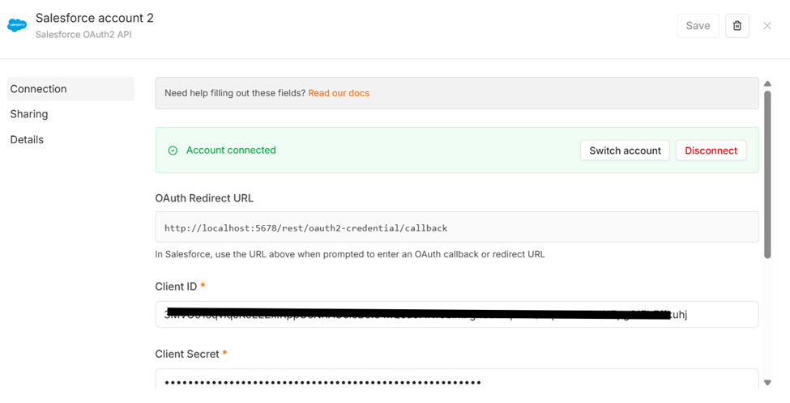
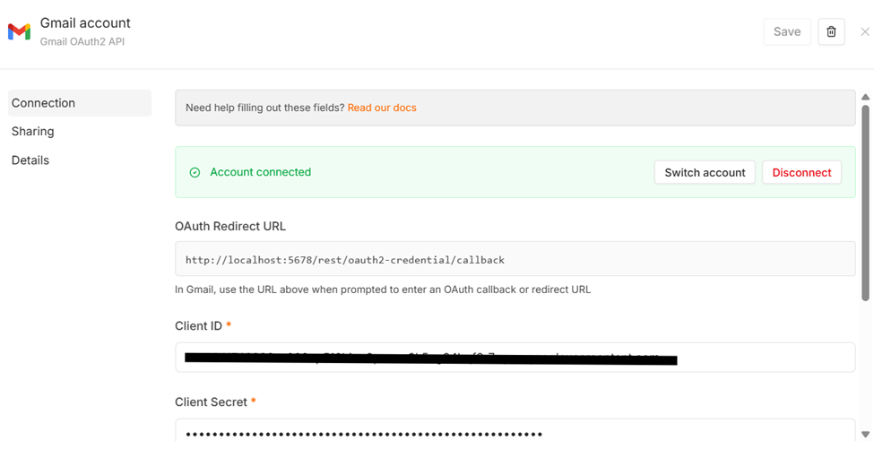
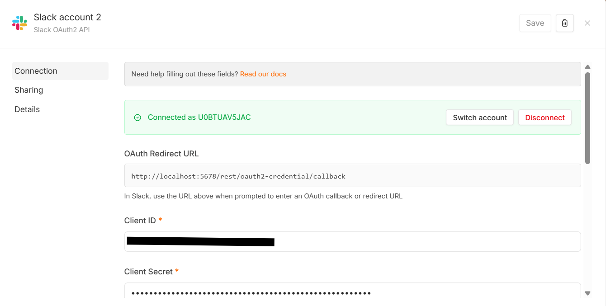

Checkpoint 4 · Clínica Odontológica: canal de correo con CRM, Gmail y Slack
Este proyecto crece módulo a módulo. Este checkpoint parte del workflow Manager del Módulo 3 (chat con memoria por Session_ID) y le suma un segundo canal de entrada, el correo de la clínica, integrado con tres herramientas externas reales conectadas por OAuth2:
Rol	Herramienta	Uso
CRM (fuente única de verdad del paciente)	Salesforce (Developer Edition)	Buscar el contacto por email; actualizarlo si existe o crearlo si no existe
Casilla de soporte	Gmail	Recibir los correos y guardar la respuesta como borrador
Canal del equipo	Slack (`#recepción`)	Avisar a recepción que hay un borrador pendiente de revisar
Credenciales (OAuth2)
Las tres conexiones están activas en n8n y las tres usan OAuth2 (Salesforce OAuth2 API, Gmail OAuth2 API y Slack OAuth2 API). En las capturas oculté los Client ID por seguridad, porque el repositorio es público. Los secretos n8n los muestra siempre ocultos.
Salesforce (CRM)

Gmail (casilla de la clínica)

Slack (canal de recepción)

Archivos
`checkpoint4\_Paulo\_Flores.json`: workflow Manager (chat + correo), el que se importa en n8n.
`worker-correo.json`: sub-workflow WORKER - CORREO, que llama el Manager.
Cómo funciona el canal de correo
```
Gmail Trigger (casilla de la clínica, cada 1 minuto)
  └─▶ ① IF ¿Correo automático o sin remitente?
        ├─ true  ─▶ No responder (corta el bucle)
        └─ false ─▶ ④ Edit Fields "Limpiar el correo" ─▶ IF ¿Email válido?
                       ├─ false ─▶ Email inválido (fin)
                       └─ true  ─▶ Llamar CORREO (WORKER - CORREO, espera la respuesta) ─▶ Log de trazabilidad (Google Sheets)

WORKER - CORREO
  ② Buscar contacto en CRM (Salesforce, por email) ─▶ ¿Existe en CRM?
        ├─ sí ─▶ Actualizar contacto
        └─ no ─▶ Crear contacto
  ─▶ Redactar respuesta (IA, gpt-4o-mini)
  ─▶ ③ Guardar borrador en Gmail (Create Draft, en el mismo hilo)
  ─▶ ④ Edit Fields "Payload para Slack" ─▶ Avisar a recepción por Slack ─▶ Respuesta OK
  Errores de Gmail o Slack ─▶ Respuesta error (status "error"), que el Manager registra en el log
```
Los 4 nodos de control que pide la consigna
IF anti auto-respuestas (resiliencia): está inmediatamente después del Gmail Trigger. Usa combinación OR con Ignore Case y descarta asuntos con Auto-reply, Out of office, Undeliverable, Fuera de la oficina, Respuesta automática, remitentes que contienen no-reply y remitentes vacíos. Esos correos van a un nodo No Operation y nunca generan respuesta, así se evita el bucle infinito de auto-respuestas.
Look up antes del Create (evita el 409): antes de crear un contacto, el worker lo busca en Salesforce por email. Si existe, lo actualiza; si no, lo crea. Lo probé enviando dos veces el mismo remitente: la primera vez se creó y la segunda se actualizó, y en Salesforce quedó un solo contacto.
Create Draft (Human-in-the-loop): el nodo de Gmail usa solo la operación Draft → Create. La IA nunca envía correos: deja el borrador dentro de la conversación del paciente y una persona de recepción lo revisa y lo envía.
Edit Fields de limpieza (evita el 400 y no satura los canales):
Limpiar el correo: deja solo remitente, nombre, asunto, texto, id del hilo e id del mensaje. Descarta adjuntos y cabeceras, corta el historial citado de respuestas anteriores y limita el texto a 2000 caracteres. Después, un IF valida que el email tenga un formato válido.
Payload para Slack: solo pasan nombre, email, asunto (hasta 80 caracteres), estado en el CRM y el enlace a Borradores. El cuerpo del correo y la respuesta de la IA no llegan a Slack.
Mínimo privilegio y privacidad
Salesforce: la credencial OAuth2 de n8n pide el alcance `full` + `refresh\_token` porque así viene definida en n8n. El mínimo privilegio lo aplico en el flujo: solo se buscan, crean y actualizan Contactos, y solo con nombre y email. Nunca guardo en el CRM el asunto ni el cuerpo del correo, porque pueden traer datos de salud.
Gmail: el flujo solo lee correos que llegan y crea borradores. No envía correos.
Slack: el flujo usa una sola operación, enviar un mensaje a un único canal (`#recepción`). El mensaje es mínimo: no lleva el cuerpo del correo ni la respuesta de la IA.
Log de trazabilidad: el email del paciente se guarda enmascarado (por ejemplo `pa\*\*\*@hotmail.com`). El caso se identifica por el id del hilo de Gmail.
IA: el prompt prohíbe dar diagnósticos o indicaciones médicas. Por correo no se reservan turnos: la respuesta deriva al chat de la clínica o al teléfono 341-602288. El contenido del correo se trata como información, no como instrucciones, para evitar que un mensaje manipule a la IA (prompt injection).
Por qué Salesforce y no HubSpot
Elegí Salesforce Developer Edition en lugar de HubSpot porque el alta de HubSpot exigió subir una foto del documento de identidad personal. Entregar un documento de identidad a un tercero para un entorno de prueba contradice el principio de minimización de datos que aplica todo el proyecto (Ley 25.326 de Protección de Datos Personales). Salesforce cumple el mismo rol de CRM, con OAuth2 y operaciones de búsqueda, creación y actualización de contactos, sin requerir ese dato.
Notas para probarlo
En esta versión de prueba, el Gmail Trigger tiene el filtro de búsqueda `CLINICA` para no procesar los correos personales de la cuenta. En la casilla real de la clínica ese filtro se quita.
Para que el correo se procese solo, el workflow Manager tiene que estar publicado (activo). El WORKER - CORREO también tiene que estar publicado.
Después de importar el JSON hay que volver a seleccionar las credenciales propias (Salesforce, Gmail, Slack, OpenAI, Airtable y Google Sheets), porque n8n no exporta las credenciales.
Prueba de regresión: el canal de chat del Módulo 3 (identificación, turnos y consultas) sigue funcionando sin cambios.
